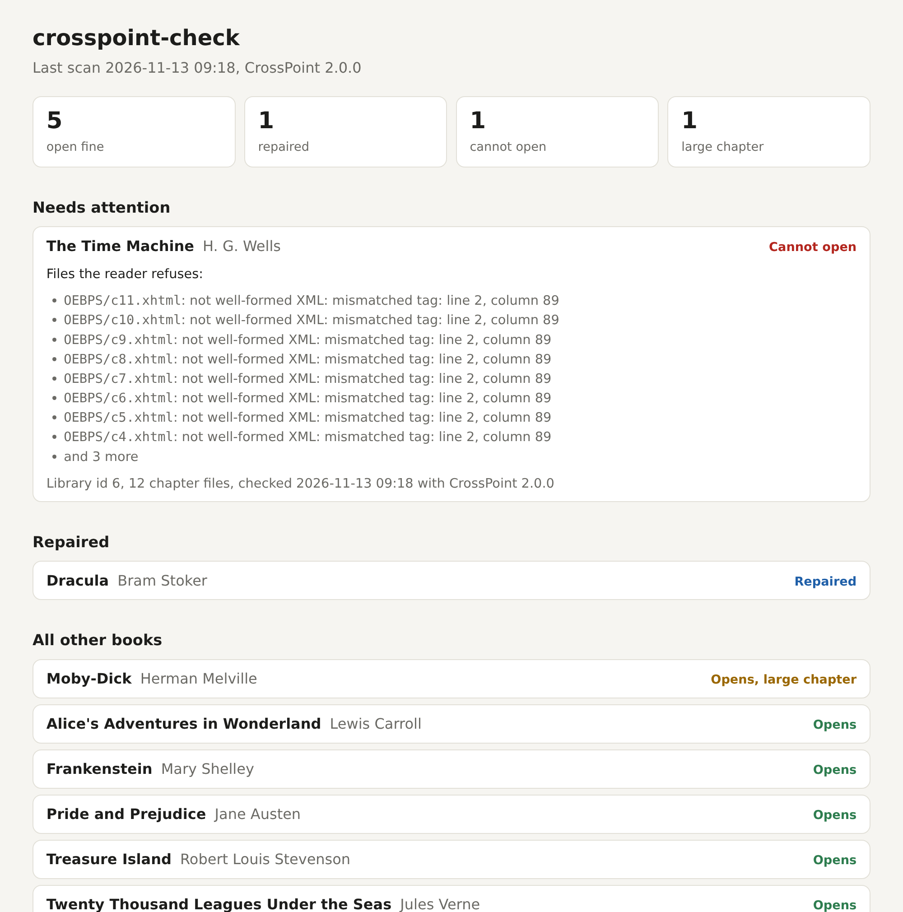

# crosspoint-check

[](https://github.com/Boisti13/crosspoint-check/releases)
[](LICENSE)
[](https://github.com/Boisti13/crosspoint-check/actions/workflows/checks.yml)

Some EPUBs won't open on an e-reader running
[CrossPoint](https://github.com/crosspoint-reader/crosspoint-reader) (Xteink X4
and others): the reader shows **"Failed to index - invalid book"**, and you
only find out once the book is on the device.

crosspoint-check finds those books before you do. It runs every book of a
Calibre library through **CrossPoint's own ZIP reader and chapter parser**,
built for your server from the firmware's source, repairs the books that
fail, and shows the result on a small status page. It was written for a
[Calibre-Web-Automated](https://github.com/crocodilestick/Calibre-Web-Automated)
library, and works with any Calibre library folder.



## Highlights

- **The firmware's parser, not a guess.** A chapter fails here exactly when
  CrossPoint's parser refuses it. The build follows the latest CrossPoint
  release by itself.
- **Watches the whole library.** New and changed books are checked every five
  minutes, however they got into the library. A first pass covers every book
  you already have.
- **Repairs what fails.** Broken chapters are rewritten as well-formed XHTML
  and oversized chapter files are split at chapter starts. The repaired copy is
  tested again and only then replaces the book; the original is kept.
- **Leaves working books alone.** A book that opens is never touched.
- **Careful with your library.** It never writes to Calibre's database, only
  replaces a book that is still the file it checked, and can run report-only.
- **Says what happened.** A status page lists every book as *opens*,
  *repaired* or *cannot open*, with the chapter and reason. A webhook can tell
  Home Assistant, ntfy or anything else that takes JSON.
- **Library on another machine?** A single-file agent serves the library over
  SSH, restricted to listing, fetching and replacing books.
- **Also a command line tool** for checking or repairing single files.

## Why books fail

Two causes cover what we have seen so far:

| Cause | What the reader does | What crosspoint-check does |
|---|---|---|
| A chapter is not well-formed XML, for example an unclosed `<meta charset="utf-8">`. Calibre-Web-Automated's EPUB fixer (seen in v4.0.8) writes exactly that into books whose charset line it doesn't recognise. | Refuses the book: *Failed to index - invalid book* | Detects it with the firmware's parser and rewrites the chapters |
| The whole book, or a very long chapter, sits in one file of several hundred KB. | Can run out of memory while building the chapter | Lists it as *large chapter* (the parser on a server has more memory than the reader, so this is a size rule, not a test); splits it if `split_large` is on, or when the book is repaired anyway |

## Install

On a Debian or Ubuntu machine (a small container is enough: 1 GB of memory for
the two-minute parser build, about 500 MB of disk), as root:

```sh
git clone https://github.com/Boisti13/crosspoint-check.git
crosspoint-check/deploy/install.sh
```

| Step | What to do |
|---|---|
| 1. Install | Run `deploy/install.sh`. It installs the packages it needs, the code in `/opt/crosspoint-check`, a scan every 5 minutes and the status page on port 8080. Run it again to update. |
| 2. Point it at the library | Edit `/etc/crosspoint-check/config.toml`: set `path` in `[library]` to the folder with `metadata.db`, or `command` for a library on another machine ([docs/remote-library.md](docs/remote-library.md)). |
| 3. Look first | `systemctl start crosspoint-check`, then open `http://<machine>:8080`. The example config has `repair = false`, so nothing in the library changes yet. |
| 4. Switch repairs on | Set `repair = true`. The next scan repairs the books that were reported. |

With Calibre-Web-Automated in Docker, the library is the folder you mounted
as `/calibre-library`; install crosspoint-check on the Docker host and use
that folder's path on the host.

### Settings

All in `/etc/crosspoint-check/config.toml`
([config.example.toml](config.example.toml)):

| Setting | Default | Meaning |
|---|---|---|
| `[library] path` | | Calibre library folder on this machine |
| `[library] command` | | Command that reaches the agent on another machine (instead of `path`) |
| `[check] repair` | `true` (example file: `false`) | Replace books the reader refuses with a repaired copy |
| `[check] crosspoint` | `"latest"` | CrossPoint release to check with, or a tag such as `"2.0.0"` |
| `[check] large_kb` | `300` | List chapter files above this size as *large chapter* (0 = off) |
| `[check] split_large` | `false` | Also split those files in books that open |
| `[check] max_kb` | `100` | When repairing, split chapter files above this size |
| `[check] images` | `false` | When repairing, also rework pictures for a 480x800 e-paper screen (black and white, baseline JPEG) |
| `[service] state` | `/var/lib/crosspoint-check` | Parser build, originals, status page |
| `[service] page_url` | | Address of the status page, sent along with notifications |
| `[notify] webhook` | | URL that gets a JSON message when books were repaired or can't be |

### Notifications

One message per scan that repaired a book or found one it can't repair, sent
as a `POST` with this body:

```json
{"title": "crosspoint-check",
 "message": "repaired Dracula; cannot repair The Time Machine",
 "repaired": [{"id": 2, "title": "Dracula", "author": "Bram Stoker"}],
 "failed": [{"id": 6, "title": "The Time Machine", "author": "H. G. Wells"}],
 "url": "https://books.example/status"}
```

For Home Assistant, make an automation with a webhook trigger and use
`{{ trigger.json.message }}` in a notification.

## A worked example

A book arrives in the library through Calibre-Web-Automated's ingest folder.
Within five minutes the scan sees it:

```text
$ journalctl -u crosspoint-check -n 3 -o cat
repaired Dracula
```

The status page moves it to *Repaired* and shows what was wrong (11 chapter
files with `not well-formed XML: mismatched tag: line 2, column 89`) and what
changed (`11 chapter files were not well-formed XML and were mended`). The
original is in `/var/lib/crosspoint-check/originals/`. On the reader the book
now opens. If you had already tried it there, delete it on the reader and
download it again: CrossPoint 2.0.0 keeps the index of the broken copy
otherwise.

The same from the command line, for single files:

```text
$ crosspoint-check check book.epub
FAIL  book.epub  (CrossPoint 2.0.0, 12 chapter files)
      OEBPS/c1.xhtml: not well-formed XML: mismatched tag: line 2, column 89
      ...
$ crosspoint-check fix book.epub fixed.epub
11 chapter files were not well-formed XML and were mended
all 12 chapter files rewritten, largest now 0 KB
OK    fixed.epub  (CrossPoint 2.0.0)
```

| Command | What it does |
|---|---|
| `crosspoint-check check FILE...` | Test EPUB files, exit code 1 if one fails |
| `crosspoint-check fix IN OUT [--images] [--max-kb N]` | Write a repaired copy and test it |
| `crosspoint-check scan [--no-repair] [--force] [--book ID]` | One pass over the library from the config file |
| `crosspoint-check page` | Rewrite the status page |

## What it can and can't promise

The check covers the firmware's ZIP reader and chapter parser, the parts
behind *Failed to index - invalid book*. A book that passes can still fail on
the device for a reason outside them, such as running out of memory. If you
find one, please open an issue with the book's structure (file sizes, the
reader's message); each case can become a rule.

Until a book is checked it can be downloaded unrepaired: there is a gap of up
to five minutes between a book landing in the library and its repair.

## Layout and development

| Path | What |
|---|---|
| `crosspoint_check/harness.py` | Clones a CrossPoint release, adds two tests, builds and runs them |
| `crosspoint_check/fixer.py` | The repair |
| `crosspoint_check/agent.py` | The only code that touches the library; standard library only, also runs alone on the library's machine |
| `crosspoint_check/library.py` | Library on this machine or behind a command |
| `crosspoint_check/service.py`, `store.py`, `page.py`, `notify.py` | The scan, its memory (SQLite), the status page, the webhook |
| `deploy/` | Installer, systemd units, SSH gate for a remote library |
| `scripts/demo.py` | Demo library with made-up books (the screenshot) |
| `scripts/deploy.sh` | Ship the committed state into a Proxmox container |

```sh
python3 -m venv .venv && .venv/bin/pip install -e '.[dev,images]'
.venv/bin/ruff check . && .venv/bin/python -m pytest -q
# Tests against a real CrossPoint build (needs git, cmake, g++, libexpat1-dev, zlib1g-dev):
.venv/bin/crosspoint-check check --cache /tmp/cp-cache some.epub      # builds it once
CROSSPOINT_CHECK_TEST_CACHE=/tmp/cp-cache .venv/bin/python -m pytest -q
```

Nothing from CrossPoint or Calibre-Web-Automated is copied into this
repository: CrossPoint's source (MIT) is cloned and built on your machine at
run time. This project is not affiliated with either.

## License

[MIT](LICENSE)
